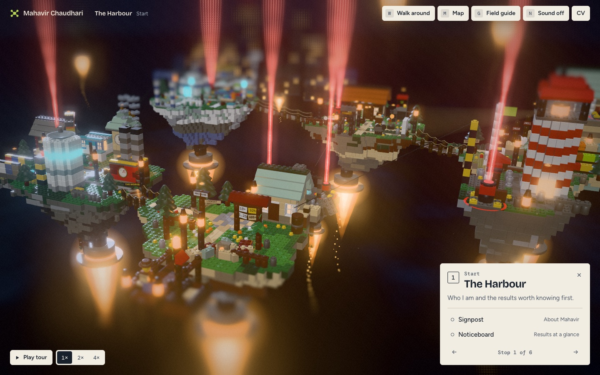
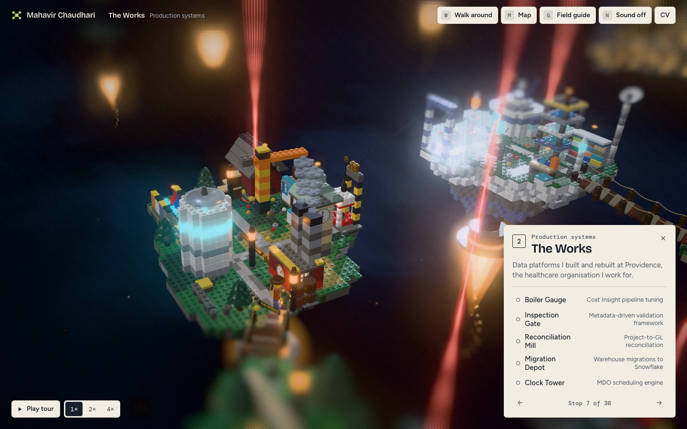
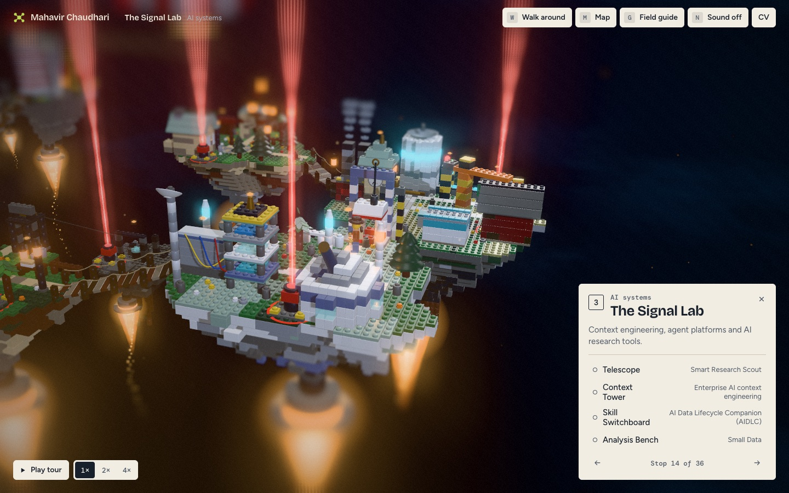
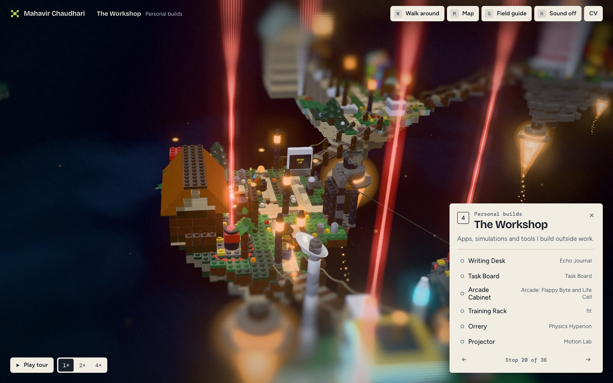
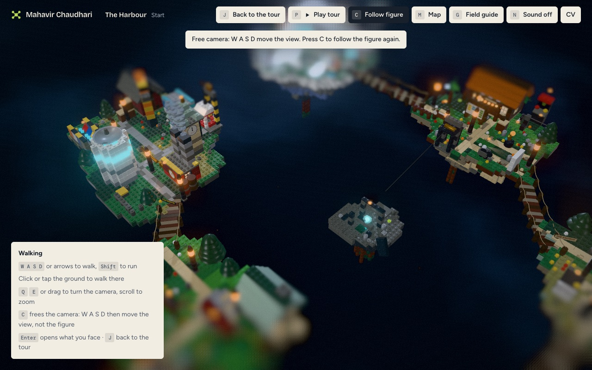
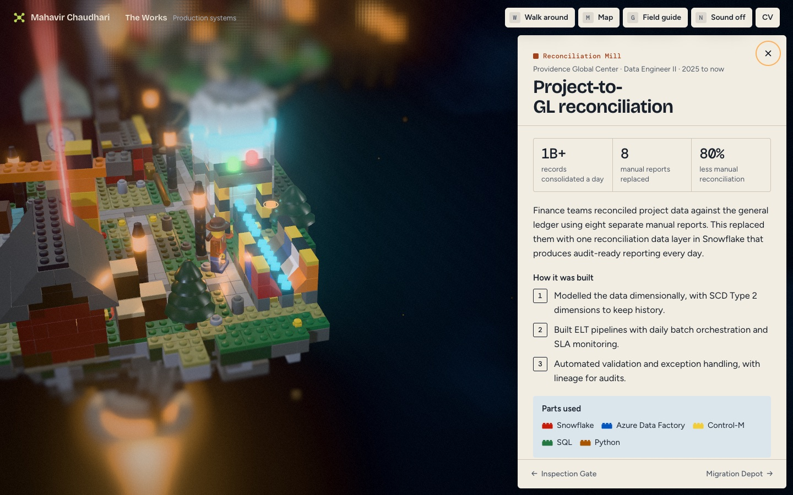
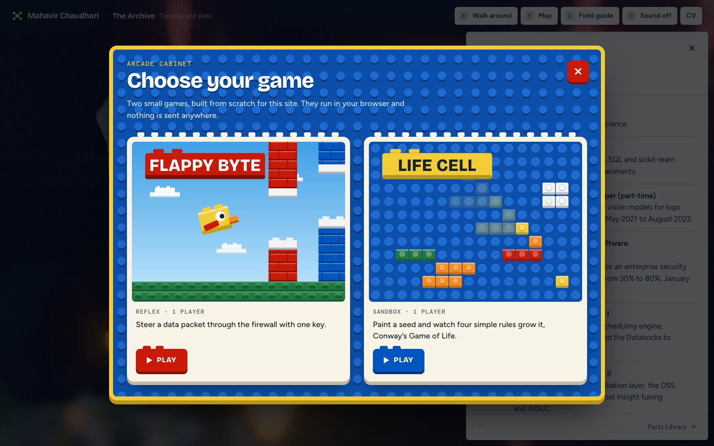

# Mahavir Chaudhari — Portfolio

An explorable world of brick-built floating islands: projects, skills, timeline and contact, all in one walkable scene.

**Live site:** [mveer1.github.io](https://mveer1.github.io)



| | |
|---|---|
|  |  |
| **The Works**: production data systems | **The Signal Lab**: AI systems |
|  |  |
| **The Workshop**: personal builds | **Free camera**: fly over the whole world |
|  |  |
| **Exhibits**: each object opens its project | **Arcade**: two small games, playable in a dialog |

## Run it

No build step; GitHub Pages serves the repository as is.

```bash
npm install     # dev tools only (Vite, Playwright, http-server)
npm run dev     # then open the printed URL
```

## Stack

Vanilla Three.js as ES modules through an import map. Every brick is generated in code, so there are no model files.

## Docs

[`docs/developing.md`](docs/developing.md) covers running, checking and extending the site: adding a project or an island, the generated blocks in `index.html`, performance, accessibility and known limitations. The rest of [`docs/`](docs) has the world design, art direction, game design, camera storyboard, content inventory and visual review.

LEGO is a trademark of the LEGO Group, which does not sponsor or endorse this site.
