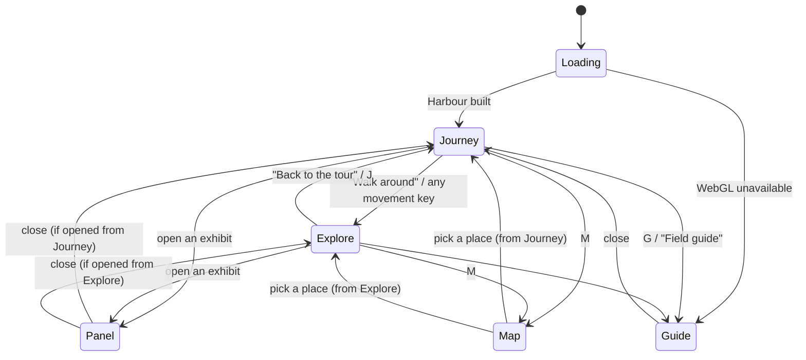

# Game design

## Goal

Let a visitor find every piece of real portfolio content by walking or scrolling through a small world, with controls they do not have to learn. Exploration is a way to reach content, not a goal of its own: no score, no XP, no currency, no locked content.

## Interaction states

| State | Who owns the camera | Who owns the figure | What scroll does |
|---|---|---|---|
| Journey (default) | the rail, from scroll progress | the route, from scroll progress | moves along the journey; up reverses it |
| Explore | the follow rig behind the figure | the keyboard, pointer or touch | nothing (page scroll is locked); wheel zooms the follow camera |
| Panel | the exhibit shot, image shifted to the free side | stands still, faces the exhibit | scrolls the panel only |
| Map | the previous state's camera, frozen | frozen | scrolls nothing |
| Guide | frozen behind the overlay | frozen | scrolls the guide |

Rules that stop the systems fighting:

1. Exactly one source writes the camera at any time. Changing state starts a blend from the camera's actual pose to the new source over 0.9 s; the new source keeps updating during the blend.
2. Entering Explore locks page scroll where it is. Leaving Explore finds the route point nearest the figure, writes that progress back into the page scroll, and the figure hops to it in three stop-motion frames. The tour then continues from where the visitor is, not from where they left.
3. A panel remembers which state opened it and returns there.
4. Map travel is a short fade cut, never a fast fly-through.

## Controls

| Action | Keyboard | Pointer | Touch |
|---|---|---|---|
| Move along the tour | scroll, Page Up/Down, Space, arrow keys | wheel, scrollbar | swipe |
| Next / previous stop | `.` / `,` or the chapter card arrows | chapter card arrows | chapter card arrows |
| Start walking freely | `W A S D` or press "Walk around" | "Walk around" button | "Walk around" button |
| Walk / run | `W A S D` or arrows, hold Shift to run | click the ground to walk there | tap the ground to walk there |
| Turn the follow camera | `Q` / `E` | drag | drag with one finger off the figure |
| Zoom (explore) | `+` / `-` | wheel | pinch is not used; buttons instead |
| Open what the figure faces | `Enter` or `F` | click any glowing exhibit | tap any exhibit |
| Close a panel or overlay | `Esc` | close button, click outside | close button |
| Map | `M` | map button | map button |
| Field guide (all content as text) | `G` | button | button |
| Back to the tour | `J` | "Back to the tour" | "Back to the tour" |
| Sound on/off | `N` | sound button | sound button |

Arrow keys scroll the tour in Journey and walk in Explore; in Journey, the first WASD press switches to Explore and shows a one-line hint about `J`.

## Interaction categories

### Portfolio interactions (23 exhibits)

Each exhibit is a physical object with a floating marker (a small amber 1×1 round tile that bobs on twos). Opening one moves the camera to its shot, the figure turns and raises an arm toward it, and the panel opens. Every exhibit is also a button in the chapter card and a section in the field guide, so nothing depends on finding it in 3D.

| Island | Exhibits |
|---|---|
| Harbour | Signpost (about), Noticeboard (results) |
| Works | Reconciliation Mill, Migration Depot, Clock Tower, Inspection Gate, Boiler Gauge |
| Signal Lab | Context Tower, Skill Switchboard (AIDLC), Telescope (Research Scout), Analysis Bench (Small Data) |
| Workshop | Task Board, Training Rack (fit), Orrery (Physics Hyperion), Writing Desk (Echo Journal), Projector (Motion Lab), Arcade Cabinet |
| Archive | Timeline Stair, Parts Library (skills), Plinth (education) |
| Lookout | Mailbox (contact form, email, LinkedIn, GitHub), Lamp Room (CV) |
| Dormant Rock | Machine Core (roadmap) |

When an exhibit opens, its machine plays its own short stepped action (the mill's hoppers drop, the clock hand sweeps from 2 h to 10 min, the switchboard drawers slide), so the opening has an outcome in the world, not only on the panel.

### Traversal interactions

| Transport | From → to | Journey | Explore |
|---|---|---|---|
| Plank, rope and stair bridges | between islands | the figure walks them | walkable |
| Cable car | Works → Signal Lab | the figure rides it, driven by scroll | press Enter at the station |
| Chain lift | Workshop → Dormant Rock | not on the tour | press Enter at the winch |
| Zip line | Lookout → Harbour | not on the tour | press Enter at the post |

### Discovery interactions

- The gate at the Harbour assembles from a loose pile as the figure walks through it (scrolling up takes it apart again).
- The Dormant Rock is visible from everywhere but not on the tour.
- Small reactions: the figure looks at the lighthouse beam when it passes, at the cable car when it arrives.

### Optional collectibles

Seven laser beacons, one per island including the hidden one (positions in `docs/world-design.md`). Each fires a red beam straight up, visible from across the world. Walking within 2.6 studs shuts one down in explore mode: the figure does a surprised jump, the beam fades, the lens turns green and a toast names the island and counts it. A counter appears in the map overlay only after the first find. Seven of seven assembles a brick model of the islands beside the harbourmaster's hut and raises a green beam from it. Progress is saved in `localStorage` as a convenience; the world works without it.

## Onboarding

- First screen: the title card, one sentence on what the world holds, two buttons ("Start the tour", "Read the field guide") and a hint line ("Scroll to travel · W A S D to walk · M for the map"; hidden on touch screens).
- The first time the visitor enters Explore, a small card lists the four controls that matter and disappears after the first movement.
- No tutorial, no forced steps.

## Leaving

Every overlay has a close button. The header always shows "CV" (the PDF) and "Field guide". The last stop of the tour offers: walk around, read the field guide, open the CV, or go back to the start. In explore mode the Lookout's zip line (signed "Back to the start") rides to the Harbour, and a toast points it out on the first visit.
