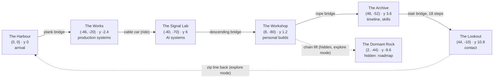

# World design

## Why this many islands

The inventory (`docs/portfolio-content-inventory.md`) has five content clusters and one unbuilt roadmap item. Each cluster became one island, sized by how much it holds. Nothing was padded to reach a number.

| Cluster in the inventory | Items | Island | Size |
|---|---|---|---|
| Identity, about text, headline results | 2 | The Harbour | medium |
| Production data engineering at Providence (P1, P3, P4, P6, P7, P8) | 5 exhibits | The Works | **largest** |
| AI systems: AIDLC, context engineering, Research Scout, Small Data | 4 exhibits | The Signal Lab | large |
| Personal builds: Task Board, fit, Physics Hyperion, Echo Journal, Motion Lab, arcade | 6 small exhibits | The Workshop | medium |
| Career timeline, earlier roles, education, skills | 3 exhibits | The Archive | medium |
| Contact, CV, profiles | 2 exhibits | The Lookout | small, highest |
| Roadmap ("Next Pipeline", not built) | 1 | The Dormant Rock (hidden) | tiny, lowest |

Changes from the brief's archetypes, and why:

- **The Core was dropped.** Its intended content (stack, databases, cloud) is a skills list. A whole island for a list would be empty; the list became the Parts Library inside the Archive, where "sorted parts" is the metaphor made literal.
- **The Engine is "The Works"** and holds five production systems instead of one generic "experience" area. This is where the evidence is densest, so it is the biggest island.
- **Echo Journal moved to the Workshop**, not the Lab. It is a personal app first; the Lab keeps the four items whose subject is AI infrastructure.
- **The Dormant Rock was added.** The roadmap item is the only thing in the workspace that is explicitly unbuilt. A half-assembled, dark machine is the honest way to show it, and it gives the world its one hidden place.

## Map

World units are studs (1 unit = 8 mm LEGO pitch). +x is east, +z is south. Elevation is the walk height of the island top.



Top view, to scale (north up):

```
              z=-80        L (-40,-70)                K (8,-80)
                             ◯  ─────────────────────── ◯
                            ╱  cable car                 ╲   ╲ chain lift
              z=-50        ╱                    · D ·     ╲    (2,-44)
                          ╱                   (hidden)     ◯ A (48,-52)
              z=-20     ◯ W (-46,-20)                      ┃ stair bridge
                          ╲                                ◯ O (44,-10)  ← highest
              z=0          ╲─── plank bridge ─── ◯ H (0,0)     ┄┄ zip line ┄┄
                                                 ┃ dock
```

The ring is walked clockwise from the Harbour. The Lookout, last on the route, sits above and beside the Harbour, so the final shot looks back at where the visitor started. The Dormant Rock hangs low in the middle of the ring, visible from every island as a dark silhouette in the fog, and is reachable only by finding the chain lift on the Workshop's south edge.

## Island inventory

### 1. The Harbour

1. **Narrative purpose:** arrival. The visitor's minifigure steps off a moored sky-skiff onto a dock. A loose pile of bricks beside the path assembles into the island gate as the visitor walks through it: the core metaphor stated once, without words.
2. **Portfolio content:** name and role; the three about paragraphs; a results board with four headline results that appear in the PDF (1B+ records a day, 92% faster scheduling, $1.25M saved, 400+ workloads migrated).
3. **Visual identity:** reddish-brown dock planks, tan stone, sand-green roofs, warm lanterns. The calmest, warmest island.
4. **Architecture:** a harbourmaster's hut with a lit window, the brick gate, a signpost pointing to every island, a noticeboard.
5. **Environment:** grass with small flowers, a lantern-lit dock, ropes, crates, the moored skiff.
6. **Landmarks:** the gate (assembled on arrival), the signpost.
7. **Interactions:** Signpost (about, and opens the map); Noticeboard (results); the skiff (decorative, rocks gently).
8. **Camera entry / exit:** opens on a wide shot of the whole set of islands from the south-east; descends to the dock; exits behind the figure facing the plank bridge with the Works' chimneys in the fog ahead.
9. **Connections:** plank bridge west to the Works; zip line arrival from the Lookout.

### 2. The Works

1. **Narrative purpose:** where the professional data engineering lives. Machines that move and merge pieces.
2. **Portfolio content:** Project-to-GL Reconciliation (P1); Databricks to Snowflake modernisation (P7) and DSS Exadata to Snowflake (P3) at the migration depot; MDO scheduling engine (P6); validation framework (P8); Cost Insight optimisation (P4).
3. **Visual identity:** dark bluish grey and black structures, dark red brick halls, yellow-and-black hazard trim, an orange crane, pearl-gold pipes. Data moves as small cyan transparent tiles: the only cyan on the island.
4. **Architecture:** the Reconciliation Mill (eight hoppers over one conveyor into a single silo), the Migration Depot (an old red warehouse, a new white-and-blue one, a crane between them), the Clock Tower, the Inspection Gate over the conveyor, the boiler house with a pressure gauge.
5. **Environment:** two chimneys with stepped smoke puffs, stacked crates, rails, warm work lamps.
6. **Landmarks:** the Clock Tower (tallest thing on the island), the crane.
7. **Interactions:** each machine opens its system. Tiles on the conveyor advance one stud per frame at 8 fps; the clock hand turns in steps; the crane swings a crate across in steps.
8. **Camera entry / exit:** establishing shot high over the chimneys; along the conveyor at figure height; exits with the cable car lifting off toward the Lab.
9. **Connections:** plank bridge east to the Harbour; cable car north to the Signal Lab.

### 3. The Signal Lab

1. **Narrative purpose:** experiments and AI systems. Quiet, high, cold light.
2. **Portfolio content:** Enterprise AI Context Engineering; AI Data Lifecycle Companion (P2, P5); Smart Research Scout; Small Data.
3. **Visual identity:** white and light bluish grey, sand blue, transparent light-blue glass, cyan lamps. The coolest island.
4. **Architecture:** an observatory dome with an opening slot, the Context Tower (stacked plates, one per context layer), a switchboard cabinet with skill drawers, a radio mast.
5. **Environment:** antenna with a cyan blink, cables, a small bench with a chart, sand-green moss.
6. **Landmarks:** the observatory telescope, the Context Tower.
7. **Interactions:** Context Tower (layers light from bottom to top in steps); Switchboard (drawers slide out one at a time); Telescope (Research Scout); Small Data bench.
8. **Camera entry / exit:** looks up at the dome from the rising cable car; tours the dome; exits down the bridge toward the warm Workshop lights.
9. **Connections:** cable car to the Works; bridge east and down to the Workshop.

### 4. The Workshop

1. **Narrative purpose:** things built for fun or for daily use, outside work.
2. **Portfolio content:** Task Board (kanban-taskboard), fit, Physics Hyperion, Echo Journal, Motion Lab, the two arcade games.
3. **Visual identity:** reddish brown, tan, dark orange, green awnings. Cluttered and warm.
4. **Architecture:** a timber shed with a lit interior and workbenches, an awning, an arcade cabinet, a film projector, an orrery.
5. **Environment:** tool racks, crates, a small tree, string lights.
6. **Landmarks:** the shed and its awning; the orrery.
7. **Interactions:** each exhibit opens its project with its live and source links. Stepping up to the cabinet and pressing Enter opens a game-select screen over the world: two big poster tiles (Flappy Byte, Life Cell) in a brick-built dialog, and both games are dressed in bricks (`#play-flappy` and `#play-life` deep links go straight to a game).
8. **Camera entry / exit:** descends with the bridge into the warm light; side-on tour of the benches; on exit the camera glances down at the Dormant Rock in the fog.
9. **Connections:** bridge to the Lab; rope bridge to the Archive; hidden chain lift down to the Dormant Rock.

### 5. The Archive

1. **Narrative purpose:** how the work got here: years, earlier jobs, school, and the sorted parts.
2. **Portfolio content:** the timeline 2019 to 2026 (from `timeline-data.js`, with the PDF's roles); Streamn and Fortranix; BITS Pilani; the skills list as sorted parts bins.
3. **Visual identity:** tan and dark tan stone, sand-green copper roof, dark red banners. Shelves of colourful bins are the only bright patch.
4. **Architecture:** the Timeline Stair (one landing per year, climbing), the Parts Library (shelves of labelled bins), a diploma plinth.
5. **Environment:** pillars, banners, a small courtyard tree.
6. **Landmarks:** the Timeline Stair.
7. **Interactions:** Timeline Stair (year by year); Parts Library (skills by category); Plinth (education).
8. **Camera entry / exit:** low shot up the stair; exits on the stair bridge, climbing toward the lighthouse beam.
9. **Connections:** rope bridge to the Workshop; stair bridge up to the Lookout.

### 6. The Lookout

1. **Narrative purpose:** the end of the route and the way to get in touch.
2. **Portfolio content:** email, a contact form (the earlier site's Formspree endpoint), LinkedIn, GitHub, the CV PDF.
3. **Visual identity:** white-and-red lighthouse, dark grey rock, a warm lamp room whose beam sweeps the islands.
4. **Architecture:** lighthouse, mailbox, signal-flag mast, a bench facing the Harbour.
5. **Environment:** bare rock, a few tufts of grass, the beam crossing the fog.
6. **Landmarks:** the lighthouse beam, visible from every island.
7. **Interactions:** Mailbox (contact form, email, LinkedIn, GitHub); Lamp Room door (CV). The flag mast is decoration. A zip line rides back to the Harbour in explore mode.
8. **Camera entry / exit:** climbs the stair bridge toward the beam; final shot pulls back to show every island lit.
9. **Connections:** stair bridge from the Archive; zip line to the Harbour.

### 7. The Dormant Rock (hidden)

1. **Narrative purpose:** something not built yet.
2. **Portfolio content:** the "Next Pipeline" roadmap, labelled as planned.
3. **Visual identity:** black and dark bluish grey, unlit, with one faint cyan pulse in the core.
4. **Architecture:** a half-assembled machine: a frame, an unconnected conveyor, loose bricks around it.
5. **Environment:** low in the fog, roots hanging below.
6. **Landmarks:** the dark machine silhouette visible from the ring.
7. **Interactions:** the machine core opens the roadmap. Reaching it is optional; the content is also in the field guide.
8. **Camera entry / exit:** explore mode only; the follow camera.
9. **Connections:** chain lift to the Workshop.

## Hidden discoveries

Seven laser beacons (`js/world/beacon.js`), one on every island including the hidden one, sit where the route passes but does not stop: behind the harbourmaster's hut, under the crane, behind the observatory, on a shed rafter, at the top of the timeline stair, beside the Lookout bench, and on the Dormant Rock. Each is a small brick blaster that fires a thin red beam straight up, so it can be spotted from anywhere in the world (the beam keeps one narrow, straight width at every distance). Walking up to one shuts it down: the figure does a surprised jump, the beam fades, the lens turns green and a toast names the island and counts the find. Progress is kept in `localStorage`. Shutting down all seven assembles a small brick model of the islands by the harbourmaster's hut, and a green beam rises from it so the reward can be found too. No score, no currency, no gating. Every portfolio item is reachable without them.

## The flying islands and what is beyond them

Every island hangs from a brick-built engine burning a small, still blue flame with a white-hot core (`js/world/thruster.js`; static on purpose, and the far rocks have none), as if the whole archipelago were travelling through space. Far out in the fog and unreachable (`js/world/wonders.js`): a drowned skyline with lights on in the cloud sea, a lighthouse that blinks HELLO in Morse, a door standing open in the sky with someone in it, a small, very distant ringed planet with a moon, and the odd shooting star. They are drawn sharp: the tilt-shift blur skips them. They are hints, not destinations.

## Walkable layout

Each island is a grid of stud cells with a walk height per cell; buildings and machines block cells. Bridges are walkable strips between two edge points with height interpolated along them (stair bridges in one-brick steps). The cable car, chain lift and zip line are ride interactions, not walkable. See `js/world/walk.js`.
